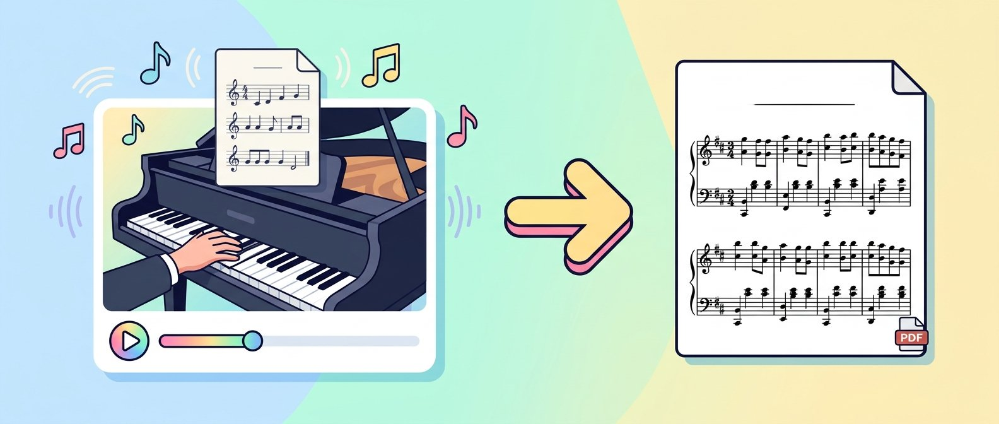

# Video Score Transcription



**An Agent Skill for Codex and Claude Code.** Give it a video where the sheet music changes in sync with an audible performance, and the agent reads the notation frame by frame, double-checks it against the audio when useful, and hands you an editable score plus a proofread PDF.

The agent does the musical reading. The bundled helpers only extract timestamped frames and render ABC to PDF, so there is no new model to train and no paid API to configure.

## Works with

| Input                                                                   | Supported                         |
| ----------------------------------------------------------------------- | --------------------------------- |
| Performance audio + score that scrolls or flips pages in sync           | ✅                                |
| Static score, silent score, hands-only or piano-roll videos, audio only | ❌ (ask for a different workflow) |

## Install

```sh
git clone https://github.com/hitokun-s/video-score-transcription.git
cp -R video-score-transcription ~/.claude/skills/video-score-transcription   # Claude Code
cp -R video-score-transcription ~/.agents/skills/video-score-transcription   # Codex
```

Start a new session if the skill is not listed yet.

## Use

```text
Claude Code: /video-score-transcription Transcribe the score in this video into ABC and a PDF.
Codex:       $video-score-transcription Turn the score in this video into PDF and MusicXML, and cross-check the audio.
```

Pass a YouTube URL or a local file. Ordinary requests about turning a video's sheet music into notation also trigger the skill.

## What you need on the machine

- `yt-dlp`, `ffmpeg`/`ffprobe`, Python 3 (Pillow for contact sheets)
- Node.js, `abcjs`, `playwright-core` and Chrome/Chromium for the PDF helper
- Optional: [ByteDance piano_transcription](https://github.com/bytedance/piano_transcription) for the audio cross-check

The PDF helper looks for its npm packages where you tell it, not inside the skill folder:

```sh
npm install --prefix ./task-tools abcjs playwright-core
node ~/.claude/skills/video-score-transcription/scripts/render-abc.mjs score.abc score.pdf --deps ./task-tools
```

## Good to know

- Verified end to end in Claude Code (Nov 2026, Linux) and Codex. Other operating systems are untested.
- Audio agreement does not prove note spelling, rhythm, voices or layout. Look at the rendered pages.
- Fast scrolling, low resolution or missing passages may need extra frames or your input; the agent says what it could not read.
- Workflow details: [SKILL.md](SKILL.md) · [notation and output](references/notation-and-output.md) · [audio check](references/audio-check.md)

## Development

```sh
npm ci && python3 -m pip install -r requirements-dev.txt
ruff check . && ruff format --check . && npm run lint && npm run format:check
python3 -m unittest discover -s tests -v   # needs FFmpeg, Pillow, Chrome (set CHROME / RENDER_NO_SANDBOX=1 if required)
```

Tests use generated media only. Related work: [Kengraver](https://github.com/katiahayati/kengraver) (scanned scores), [Rescored](https://github.com/calebyhan/rescored) (YouTube audio), [abcjs](https://github.com/paulrosen/abcjs).

## License

MIT for the skill text, helpers and tests ([LICENSE](LICENSE), [THIRD_PARTY_NOTICES.md](THIRD_PARTY_NOTICES.md)). The license covers none of the input videos, compositions, sheet music or transcriptions you process; nothing of that kind is included here.
